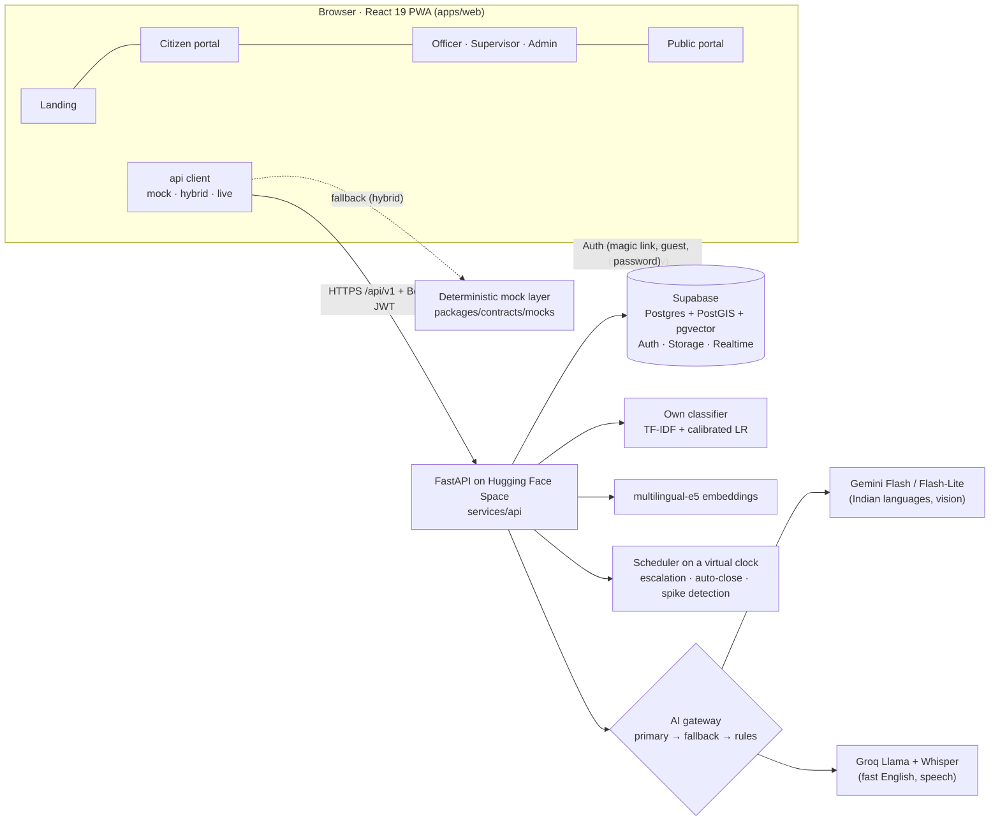
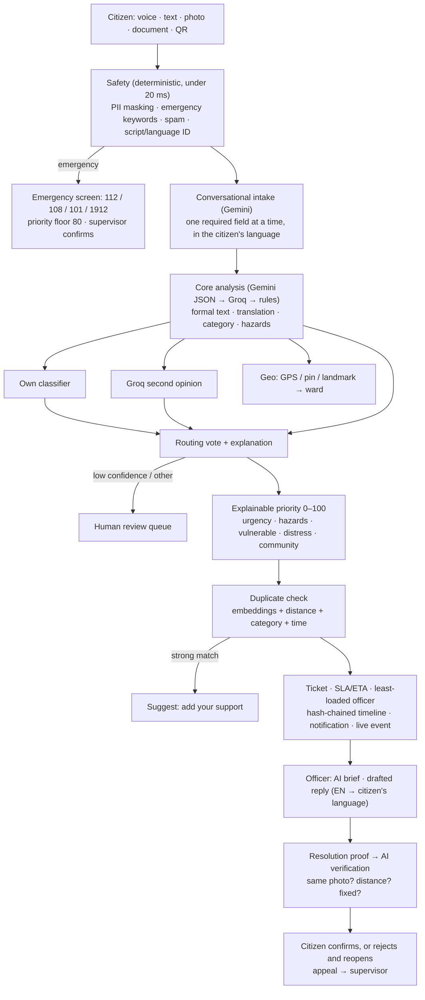

# JanaVaani — voice of the people

> **Speak your problem, in your language. JanaVaani takes it to the right office and stays with it until it is really fixed.**

A voice-first, multilingual citizen grievance platform for Telangana and Hyderabad. A citizen speaks or types a complaint in **Telugu, Hindi, Urdu, English or code-mixed Tenglish/Hinglish**, or just takes a photo. AI turns it into a structured, correctly routed, prioritized case. Officers act on it with AI briefs. The case closes only when **the citizen confirms the fix**, and every step is on a tamper-evident audit trail.

Neural Storm (JNTUH) · Problem statement **HI-02** · Multilingual Citizen Grievance Chatbot.

**Why it is different**
- **Built for the people who need it most:** voice-to-voice in Indian languages, an easy (low-literacy) mode, large text, high contrast, and Urdu right-to-left. It is tuned for mid-range Android phones (Lighthouse mobile 85+) and works offline (PWA + outbox).
- **More than a chatbot:** four connected portals and an AI engine with its own trained classifier. Every AI task has a fallback.
- **A trust layer:** AI checks resolution photos ("this proof is the citizen's own photo"), closures need the citizen's confirmation, the audit chain is hash-linked and verifiable, and public data is anonymized.
- **AI is advisory:** rules and humans decide emergencies, critical priority, low-confidence routing and disputed closures.
- **Free and open stack:** free tiers only, synthetic data only.

---

## Features by portal

| Surface | Path | Who | Highlights |
|---|---|---|---|
| **Landing** | `/` | Everyone | 3D "City Pulse" of Hyderabad (complaints glow by department), multilingual hero, scroll story, live city stats, "one complaint, any language" showcase |
| **Citizen portal** | `/app`, `/track`, `/r/:assetId`, `/guide` | Citizens, guests | Chat + voice report assistant, photo-first 3-tap report, QR asset reports, tracker, verify/reopen/appeal, nearby issues, service guide |
| **Department portal** | `/officer`, `/supervisor` | Officers, supervisors | Priority inbox, case view (original next to English), AI brief, drafted replies in the citizen's language, resolution proof, review queues |
| **Government admin** | `/admin` | Admins | KPIs, heatmap, department leaderboard, spike alerts, audit chain verification, AI model page with retrain, demo clock |
| **Public transparency** | `/public` | Everyone | Anonymized heatmap, resolution rates, trends, before/after of fixed issues |
| **AI engine** | `services/api` | — | Translate, classify, prioritize, detect duplicates, route, verify resolutions, escalate |

### Citizen portal (Laptop A)
- **Report assistant** (`/app/report`): a conversation driven by `POST /chat/turn`.
  - Detects language and script, including Tenglish and Hinglish.
  - Asks the department's required questions one at a time.
  - Shows a confirmation card: the formal complaint in the citizen's language, an English toggle and the original words; a routing preview (department, office, officer, confidence, explanation); an explainable priority score with SLA; anonymous and private toggles.
- **Voice mode:** a full-screen audio-reactive orb with a voice-to-voice loop.
  - Web Speech with live captions, falling back to recording + Whisper.
  - Voice confirmation ("avunu", "haan", "جی ہاں").
  - Voice navigation ("open my complaints" / "నా ఫిర్యాదులు").
- **Emergency takeover:** big 112 / 108 / 101 / 1912 call buttons render first, then you can continue registering. Critical priority is sent for human confirmation.
- **Duplicates:** "32 people already reported this" → *Add my support* instead of filing again.
- **Photo-first quick report** (`/app/report/quick`), **"read a notice or bill"** (AI reads a photographed document and drafts the complaint), and a **QR asset entry** (`/r/:assetId`) that pre-fills a streetlight or drain report.
- **Tracker:**
  - 7-step progress and the full activity history (including transfer reasons).
  - SLA countdown with ETA and delay reason; office card.
  - Before/after slider with the AI verification verdict.
  - Officer messages in the citizen's language with **Listen**.
  - **"Is it fixed?"** (stars, or reopen with reason + photo) and appeals; receipts and PDF reports that render Indic scripts correctly.
- **Guest tracking** with ticket ID + PIN, **notifications** with realtime toasts, **nearby issues** with "I'm affected too", a multilingual **public-service guide**, and **share on WhatsApp** (a free `wa.me` link, never the PIN).
- **Accessibility and reach:**
  - Easy mode: one question at a time, icon tiles, auto read-aloud, big ✓/✗.
  - Large text, high contrast, reduced motion; Urdu RTL.
  - WCAG 2.1 AA (axe-checked in four themes).
  - Installable PWA with an offline shell and an offline outbox.

### AI engine (Laptop B)
Safety rules → Gemini analysis → own classifier + Groq second opinion → routing vote → explainable priority → duplicate check (embeddings + PostGIS + time window) → SLA/ETA → least-loaded officer → hash-chained audit → live event. Details below and in [`docs/architecture.md`](docs/architecture.md).

### Government portals (Laptop C)
- **Officer inbox:** emergencies first, then overdue critical cases, then score.
- **Case workspace:** translation view, AI brief, draft replies, internal notes, reassign, resolve with proof.
- **Supervisor review queues:** routing, emergency, disputed, appeals.
- **Admin command center:** maps, analytics, alerts, insights, audit, AI metrics with retrain, demo controls and exports.
- **Public transparency portal.**

---

## Architecture



The **contract is shared and typed**: `packages/contracts/src/types.ts` mirrors the Pydantic models in `services/api/app/schemas.py` (snake_case end to end). The frontend has three API modes: `mock` (no backend), `hybrid` (live API, falls back to mocks on network error, 404, 501, timeout or a token-less 401) and `live`.

## AI workflow (per complaint)



Every AI task has a primary and a fallback provider, plus a deterministic rule. With no API keys at all, the whole system still runs (offline mode, used by the test suite).

---

## Tech stack (free tiers only)

| Layer | Technology |
|---|---|
| Frontend | React 19, Vite, TypeScript (strict), Tailwind CSS v4, shadcn/ui (Radix), lucide-react |
| Motion & 3D | `motion`, three.js, @react-three/fiber + drei, Lenis (landing only) |
| Data & state | TanStack Query v5, zustand, react-router v7 |
| i18n | i18next (en, te, hi, ur deep; ta, kn, ml, mr, bn, gu understood), RTL for Urdu |
| Maps & charts | Leaflet + react-leaflet, OpenStreetMap tiles, Recharts, TanStack Table |
| Documents | html-to-image + jsPDF (Indic-safe PDFs), qrcode, SheetJS |
| PWA | vite-plugin-pwa (offline shell, outbox in IndexedDB) |
| Backend | Python 3.11+, FastAPI, Pydantic v2, SQLAlchemy/psycopg 3, APScheduler, slowapi |
| ML | scikit-learn (TF-IDF + calibrated logistic regression), sentence-transformers `multilingual-e5-small` |
| Testing | Playwright (Chromium, Edge, Pixel 7), axe-core, pytest |

| Free service | Used for |
|---|---|
| **Supabase** free project | Postgres + PostGIS + pgvector, Auth (magic link, anonymous guests), Storage, Realtime |
| **Vercel** Hobby | Frontend hosting |
| **Hugging Face Spaces** (Docker, CPU) | Backend API |
| **Gemini API** free tier | Indian-language generation, translation, vision (photos, documents, resolution checks) |
| **Groq** free tier | Fast English reasoning, second-opinion routing, Whisper speech-to-text |
| Browser Web Speech API | Live captions and read-aloud |
| OpenStreetMap / Nominatim | Basemaps and geocoding (attributed) |

No SMS, WhatsApp Business, IVR or paid maps. The WhatsApp share is a plain `wa.me` link.

---

## Demo accounts

Seeded by `ml/seed_db.py`; one-click buttons on `/login` when `VITE_DEMO_MODE=true`. Password for all: **`Demo@2026`**. The `.test` domain never sends real email.

| Role | Email | Persona |
|---|---|---|
| Citizen | `lakshmi@janavaani.test` | Lakshmi Devi, Kukatpally, prefers Telugu |
| Citizen | `imran@janavaani.test` | Imran Khan, Charminar, prefers Urdu |
| Officer | `ravi.roads@janavaani.test` | Ravi Kumar, AE Roads (Kukatpally + Serilingampally) |
| Officer | `sunitha.electrical@janavaani.test` | Sunitha Reddy, AE Electrical (streetlights + power) |
| Officer | `farhan.water@janavaani.test` | Farhan Ali, Manager Water Supply (Charminar) |
| Supervisor | `supervisor@janavaani.test` | Deputy Commissioner, all departments |
| Admin | `admin@janavaani.test` | Commissioner's Office |

Guests use **Continue as guest** and get a ticket ID plus a 6-digit PIN for `/track`.

**Demo stories in the seed data:**
- A live wire near a school (Kukatpally).
- A 32-report pothole incident at Miyapur X Roads.
- A contaminated-water spike in Urdu/Hindi (Charminar + Falaknuma).
- A suspicious streetlight closure (the officer re-used the citizen's photo).
- A drainage complaint reopened 3 times (Malakpet).
- A monsoon pattern in the history charts.

---

## Local setup

### Frontend only (mock mode, no backend needed)
```bash
npm install
cp apps/web/.env.example apps/web/.env.local   # VITE_API_MODE=mock
npm run dev                                     # http://localhost:5173
```

### Backend (offline mode: SQLite + deterministic AI fallbacks, no keys needed)
```bash
cd services/api
python -m venv .venv && . .venv/bin/activate
pip install -r requirements.txt
cp .env.example .env              # leave DATABASE_URL and keys empty for offline mode
cd ../.. && python ml/seed_db.py  # the demo city
cd services/api && uvicorn app.main:app --reload --port 8000
```
Then point the frontend at it: in `apps/web/.env.local`, set `VITE_API_MODE=hybrid` and `VITE_API_BASE_URL=http://localhost:8000/api/v1`. **Live mode:** fill `services/api/.env` (Supabase Session-pooler URI, Gemini and Groq keys), run `python ml/apply_migrations.py`, then `python ml/seed_db.py`.

### Scripts (repo root)
| Command | What it does |
|---|---|
| `npm run dev` / `npm run build` / `npm run lint` | Vite dev server · type-check + production build · ESLint |
| `npm run test:e2e` | Playwright (Chromium, Edge, Pixel 7); builds and serves the app itself |
| `npm run test:mocks` · `test:voice` · `test:i18n` | Mock endpoints · voice words/navigation · i18n/RTL hygiene |
| `npm run analyze -w apps/web` | Bundle report (gzip per chunk, critical-path total vs the 250 KB budget) |
| `cd services/api && pytest` | Backend tests (offline mode) |

## Deployment

1. **API (Hugging Face Space, Docker SDK, port 7860):** `docker build -f services/api/Dockerfile -t janavaani-api .` from the repo root.
   - Set the `services/api/.env` values as Space secrets. Use the Supabase **Session pooler** URI, because the direct connection is IPv6.
   - Include the frontend origin in `ALLOWED_ORIGINS`.
   - Warm the AI cache with `python scripts/record_demo.py --base https://<space>.hf.space/api/v1`.
2. **Frontend (Vercel):** import the repo; `vercel.json` sets the install, build, output and SPA rewrites. Environment:
   ```
   VITE_API_MODE=live
   VITE_API_BASE_URL=https://<space>.hf.space/api/v1
   VITE_SUPABASE_URL=…            VITE_SUPABASE_ANON_KEY=…
   VITE_DEMO_MODE=true
   ```
3. **Backup site:** a second Vercel deployment with `VITE_API_MODE=mock` runs the whole demo with no backend.

Demo-day runbooks: [`docs/runbook.md`](docs/runbook.md) (API), [`docs/demo-script.md`](docs/demo-script.md) (4-minute script) and [`docs/demo-video-checklist.md`](docs/demo-video-checklist.md) (recording).

---

## Repository layout
```
apps/web/            React frontend for every portal (src/app, lib, design = shared foundation)
  src/portals/       landing · citizen (A) · officer · admin · public · gov-shared (C)
packages/contracts/  Shared API contract (types.ts = master §8, endpoints.md) + deterministic mock layer
services/api/        FastAPI backend: routers, AI gateway, pipeline, scheduler (B)
ml/ data/ supabase/  Classifier training/eval, seed + reference data, SQL migrations (B)
e2e/                 Playwright: citizen/ (A) · gov/ (C)
docs/                specs, progress per laptop, contract notes, architecture, runbooks
```

## Team

Three laptops built the project in 48 hours, each on its own branch, with integration merges at H30 and H42.

| Part | Branch | Built by (commit authors) | Scope |
|---|---|---|---|
| **A** · Foundation, landing, citizen portal; integrator | `feat/citizen` | Vidur-2007 | Scaffold, design system, API client + mock layer, auth, i18n, landing, every citizen screen, PWA, accessibility |
| **B** · AI engine, backend, data, ML | `feat/ai-engine` | gmur0844-eng, geddam satya | FastAPI, Supabase schema + RLS, AI gateway, classifier, pipeline, seed data, escalation |
| **C** · Government and public portals | `feat/gov-portals` | anugnya | Officer, supervisor, admin and public portals, gov components, realtime, exports |

---

*Demo data only: every complaint, person and photo is synthetic. Ward boundaries are approximate demo boundaries, not official jurisdictions. Department-to-agency mapping is illustrative. Basemap data © OpenStreetMap contributors.*
