<div align="center">

# JanaVaani — జనవాణి · जनवाणी · جن وانی

### *Speak your problem. In your language. Watch it get fixed.*

**A voice-first, multilingual AI grievance platform for Indian citizens and governments**

**Neural Storm 2026 (JNTUH) · Track: Human Impact · Problem Statement HI-02 — Multilingual Citizen Grievance Chatbot**

[**Live demo**](https://jana-vaani.vercel.app/) · [**Demo video**](https://drive.google.com/file/d/1B0nkLYo7i5t_8-uhb5MTGe_d1eEqREDQ/view?usp=drive_link) · [**API docs**](https://jana-vaani.vercel.app/docs) · [**Model metrics**](ml/models/metrics.json)


-brightgreen)

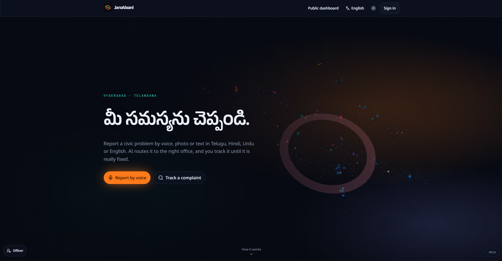

</div>

---

## Team

**Team name:** Maximus Decimus Meridius

**Members:**

- Vidur Bandaru
- Murari Guddam
- Anugnya.S

We split the work into three parts, each built on its own branch: the citizen portal and shared frontend (`feat/citizen`), the AI engine, backend and ML model (`feat/ai-engine`), and the department, admin and public portals (`feat/gov-portals`).

---

## Table of contents

1. [The problem](#1-the-problem)
2. [Our approach](#2-our-approach)
3. [Features](#3-features)
4. [How the AI works](#4-how-the-ai-works)
5. [Our ML model and results](#5-our-ml-model-and-results)
6. [Architecture](#6-architecture)
7. [Tech stack](#7-tech-stack)
8. [Screenshots](#8-screenshots)
9. [Run it locally](#9-run-it-locally)
10. [Demo accounts and walkthrough](#10-demo-accounts-and-walkthrough)
11. [Privacy, safety and responsible AI](#11-privacy-safety-and-responsible-ai)
12. [AI tools used](#12-ai-tools-used)
13. [Limitations and future work](#13-limitations-and-future-work)
14. [Repository structure](#14-repository-structure)

---

## 1. The problem

Public grievance systems in India are built for people who are comfortable typing formal English or Hindi into long web forms. The citizens who suffer most from broken streetlights, overflowing drains and contaminated water often are not.

- **Language barrier.** Telangana's citizens speak Telugu, Urdu, Hindi and English, and very often a mix ("Tenglish": *"Miyapur X roads lo pedda gunta undi"*). Most portals understand none of that well.
- **Literacy barrier.** Long forms with department drop-downs assume the citizen already knows which department is responsible.
- **Misrouting and duplicates.** Complaints land in the wrong department, and fifty people reporting the same burst pipe create fifty separate work orders.
- **No trust in closure.** Cases are often marked "resolved" by the officer without the citizen ever confirming the problem was actually fixed.
- **No visibility for administrators.** Patterns (a spike in water contamination in one ward, a road that keeps breaking) stay hidden in thousands of free-text tickets.

**HI-02 asks for an NLP chatbot that accepts grievances in regional Indian languages, routes them to the right department, and tracks resolution.** JanaVaani does that, and builds the rest of the loop around it: officer tools, verified closure, and city-wide intelligence.

---

## 2. Our approach

JanaVaani is **four connected portals around one AI engine**:

| Portal | For | What it does |
|---|---|---|
| **Citizen Portal** | Citizens, guests | Report by voice, text, photo or QR code in any supported language; track, verify, appeal |
| **AI Intelligence Engine** | (backend) | Translate, classify, prioritize, detect duplicates, route, verify resolutions |
| **Department Portal** | Officers, supervisors | Priority inbox, AI case briefs, translated two-way messaging, proof-of-work, review queues |
| **Government Admin Portal** | Administrators | Live KPIs, heatmaps, department rankings, spike alerts, tamper-evident audit, AI model monitoring |
| **Public Transparency Portal** | Everyone | Anonymized resolution statistics and heatmap |

Five design principles drove every decision:

1. **Voice first, any language.** A citizen who cannot read or type can still file a complete complaint, entirely by speaking, and hear the replies.
2. **Our own model, not just an API wrapper.** Department routing combines **our trained multilingual classifier** with two LLM opinions (Gemini and Groq). When they disagree, a human decides, and that correction retrains our model.
3. **AI recommends, humans decide.** Emergencies, critical priorities, low-confidence routing and disputed closures always go to a human. Safety rules can raise a priority; the AI can never lower it.
4. **Closure needs proof.** An officer's "resolved" is checked by AI against the original photos, then confirmed (or rejected) by the citizen.
5. **₹0 to run.** Every service is free and open source, so a municipality could pilot it tomorrow.

---

## 3. Features

<details open>
<summary><b>Citizen Portal</b></summary>

- **Multilingual chat** with **automatic language detection.** Telugu, Hindi, Urdu and English get the full app in that language. Complaints in Tamil, Kannada, Malayalam, Marathi, Bengali and Gujarati are also understood, and the AI replies in the same language (the screens stay in the four main languages).
- **Code-mixed and transliterated text:** understands Tenglish and Hinglish written in English letters.
- **Voice Mode:** speech-to-text, text-to-speech and full voice-to-voice conversation, with an audio-reactive orb and voice confirmation ("avunu", "haan", "yes"). Spoken navigation too: "open my complaints", "నా ఫిర్యాదులు", "मेरी शिकायतें", "میری شکایات".
- **Conversational registration:** asks one natural follow-up question at a time for missing details (location, duration, photo), and remembers earlier answers.
- **AI-written title and formal complaint** in the citizen's own language, shown for approval. The citizen's original words are always kept.
- **Photo-to-Grievance:** upload a photo and the AI suggests the category and severity and checks the photo is clear enough, in three taps.
- **Read a notice or bill:** photograph a water bill or official notice; the AI summarizes it in the citizen's language and drafts the complaint text.
- **Location from GPS, map pin, typed landmark or text** ("near ZPHS school"), resolved to a ward.
- **Multiple problems in one message** are split into separate cases, with confirmation.
- **Duplicate detection before submitting:** "32 people already reported this — add your support?", even across languages.
- **Emergency takeover:** words like "live wire" or "కరెంటు తీగ" instantly show one-tap emergency numbers (112, 108, 101, 1912) before anything else.
- **Anonymous, private and guest reporting** (guests get a ticket ID plus PIN).
- **QR codes on public assets** (streetlights, bins) open a pre-filled report, or let the citizen support an existing one.
- **Live tracking:** 7-step visual timeline, SLA countdown, expected resolution time, delay reasons and the assigned office.
- **Status by chat in any language:** "నా నీటి ఫిర్యాదు ఏమైంది?" (What happened to my water complaint?)
- **Verify the fix:** before/after slider, AI verification badge, accept with a star rating, or reject and reopen with a photo; formal appeals with their own tracking.
- **Downloadable receipt and status report** (PDF with a QR code; Indic scripts render correctly) and **share on WhatsApp** (never includes the guest PIN).
- **Cross-language search** across your complaints.
- **Nearby issues** map with a search radius, **public-service guide** chatbot with sources, **in-app realtime notifications.**
- **Accessibility:** low-literacy mode, large text, high contrast, reduced motion, simple mode, screen-reader and keyboard support, right-to-left layout for Urdu.
- **Installable app (PWA)** with offline drafts that send automatically when back online.

</details>

<details open>
<summary><b>AI Intelligence Engine</b></summary>

- One structured analysis call per complaint: language, script, translation, title, summary, formal text, category, sub-department, urgency, hazards, vulnerable groups, sentiment, distress and photo analysis.
- **Three-way routing vote:** our classifier + Gemini + Groq, with a confidence score and a plain-language explanation of why.
- **Explainable priority score (0–100)** listing every factor that contributed.
- **Semantic, cross-language, location-aware duplicate detection** (pgvector + PostGIS), with incident clustering.
- **Ward and jurisdiction detection** from GPS or text.
- **Least-loaded officer assignment** within the right department and ward.
- **AI resolution verification:** compares the officer's proof photo with the citizen's photo, checks distance, and detects re-used photos.
- **Multi-level SLA escalation**, automatic alerts and **statistical spike detection.**
- **Personal data masking** (Aadhaar, phone, email, PAN) before any text reaches an AI provider.
- **Every AI task has a fallback provider**, and the system still works with rules plus our own model if both LLMs are unavailable.

</details>

<details open>
<summary><b>Department Portal (officers and supervisors)</b></summary>

- Priority-sorted inbox: emergencies first, then critical overdue, then priority score and SLA.
- Filters, ID search and semantic search in any language; bulk actions and incident merging.
- **AI case brief:** situation, evidence, risks, suggested next steps, missing information, similar resolved cases.
- **Original text next to its English translation.**
- **AI-drafted replies** in English that the citizen receives in their own language, with audio.
- Status updates with delay reasons, internal notes, reassignment (which trains the model).
- **Geotagged proof-of-work photo** with instant AI verification.
- Supervisor queues for low-confidence routing, emergency confirmation, disputed closures and appeals.

</details>

<details open>
<summary><b>Government Admin Portal</b></summary>

- **Command center:** live KPI cards, city heatmap, alerts, AI insights and department leaderboard.
- Interactive map with heatmap, clusters, ward boundaries, incidents and a 30-day replay slider.
- Department performance ranking with a transparent scoring formula; officer workload.
- Trends, ward/zone/category breakdowns, delay-risk predictions.
- **Spike alerts** (e.g. a sudden rise in contaminated-water complaints in one ward).
- **Disaster Surge Mode:** a war room with live counts, an affected-area map and a team assignment board.
- **Root-cause graph** linking related failures (rule-based).
- **Asset pages** (history, open issues, citizen QR) and a **printable QR sheet** per ward.
- **AI-written trend summaries that may only use numbers computed by the database** (verified automatically).
- **Tamper-evident audit trail** (SHA-256 hash chain) with visual verification.
- **AI model page:** accuracy per language, confusion matrix, live routing stats, version history and one-click **retrain from human corrections.**
- CSV, Excel and PDF export.
- Every government screen is available in English, Telugu, Hindi and Urdu.

</details>

<details open>
<summary><b>Public Transparency Portal</b></summary>

- City-wide resolution rate and average resolution time, department report cards, zone comparison.
- Anonymized heatmap (locations blurred by ~75 m, no text, no identities).
- Recently fixed issues, with before/after proof photos when the case has them.

</details>

---

## 4. How the AI works

Every complaint passes through this pipeline. The rules and our own model run in milliseconds (offline pipeline: median 29 ms per submission). The LLM steps add a few seconds, depending on the provider.

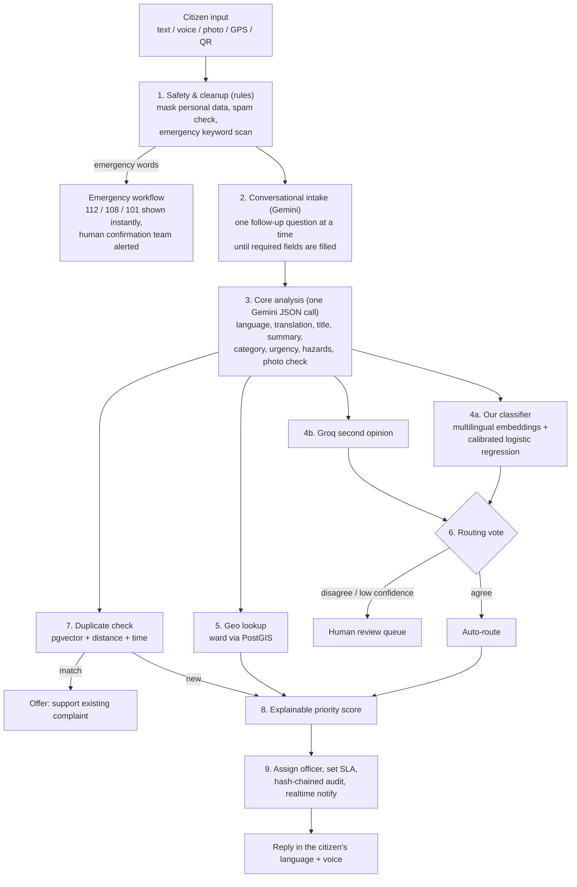

### Routing vote

```
label      = majority of { our classifier, Gemini, Groq }
confidence = 0.5 × P(classifier, label) + 0.25 × [Gemini agrees] + 0.25 × [Groq agrees]

confidence ≥ 0.75  → routed automatically
0.50 – 0.75        → routed, flagged for a quick check
< 0.50 or "other"  → human review queue (the decision becomes training data)
```

### Priority score (0–100, every factor shown to users)

| Factor | Points |
|---|---|
| AI urgency (critical / high / medium / low) | 70 / 50 / 30 / 15 |
| Each hazard (live wire, open manhole, sewage overflow…) | +10, max +20 |
| Emergency keyword rule hit | minimum score of 80 |
| Distress in the message | +0 to +10 |
| Children, elderly, disabled or pregnant people affected | +8 |
| Number of people reporting the same issue | up to +15 |

Critical priority always needs human confirmation.

### Which AI does what

| Task | Primary | Fallback |
|---|---|---|
| Conversation, analysis, translation, replies to citizens | Gemini Flash | Groq |
| Photo understanding and resolution verification | Gemini Flash (vision) | Marked "unclear" for human review |
| Routing second opinion, officer briefs, reply drafts, trend summaries | Groq | Gemini Flash-Lite |
| Speech-to-text | Browser speech recognition | Groq Whisper |
| Department classification | **Our own model** | Always available, no external calls |

Rule of thumb: anything a citizen reads in an Indian language, or anything with an image, goes to Gemini; internal English text that must be instant goes to Groq.

---

## 5. Our ML model and results

### The model

| | |
|---|---|
| **Task** | Predict the responsible department (11 classes) from a complaint in any supported language or script |
| **Embeddings** | `intfloat/multilingual-e5-small` (384-d). Fallback: TF-IDF character 2–5 + word 1–2 n-grams, used where the embedding model can't run |
| **Classifier** | Logistic regression (class-balanced) with calibrated probabilities (`CalibratedClassifierCV`) |
| **Training data** | 2,508 synthetic, template-generated complaints (2,116 train / 392 test) across 11 departments, in Telugu, Hindi, Urdu, English and code-mixed Tenglish/Hinglish. Split by phrase, so no wording appears in both train and test. English translations are added as training-only augmentation |
| **Human test set** | 48 hand-written complaints, separate from the training templates and never used in training |
| **Training time** | Seconds on a laptop CPU, no GPU needed |
| **Learning loop** | Officer and supervisor routing corrections are stored and weighted ×3 on retraining |

### Results

Model version `v20261102-160627`:

| Test set | Accuracy | Macro-F1 | Samples |
|---|---|---|---|
| Synthetic held-out test (phrase-group split) | 86.7 % | 0.878 | 392 |
| **Human-written test set** | **89.6 %** | **0.900** | 48 |
| *TF-IDF fallback, synthetic test* | *80.6 %* | *0.815* | *392* |
| *TF-IDF fallback, human-written test* | *77.1 %* | *0.795* | *48* |

**Accuracy by language**

| Test set | Telugu | Hindi | Urdu | English | Code-mixed (Tenglish/Hinglish) |
|---|---|---|---|---|---|
| Human-written (n) | 88.9 % (9) | 75.0 % (8) | 85.7 % (7) | 100 % (14) | 90.0 % (10) |
| Synthetic (n) | 64.6 % (65) | 82.8 % (64) | 100 % (59) | 93.1 % (102) | 89.2 % (102) |

The human-written set is small, so treat the per-language numbers as indicative. The synthetic set is template-generated, so its numbers are optimistic.

**Full routing system.** The Admin → AI model page shows live routing stats: share routed automatically, share sent to human review, and classifier–LLM agreement. We have not benchmarked these on real complaint traffic.

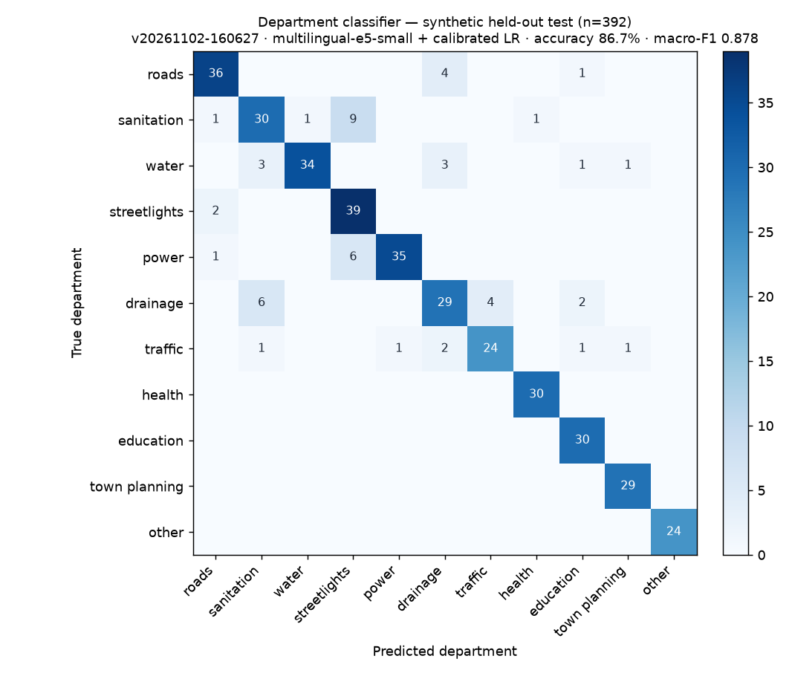

Reproduce these numbers with `python ml/train_classifier.py` (trains the e5 and TF-IDF models) and `python ml/evaluate.py e5`. All numbers above come from [`ml/models/metrics.json`](ml/models/metrics.json) and [`ml/models/metrics_tfidf.json`](ml/models/metrics_tfidf.json). The notebook [`ml/notebooks/model_report.ipynb`](ml/notebooks/model_report.ipynb) analyses the dataset and sample predictions; it was run on an earlier TF-IDF version of the model.

> **Why a trained model plus LLMs?** LLMs are strong but can be confidently wrong, are rate-limited on free tiers, and are not ours. Our classifier is fast, free, always available, gives calibrated probabilities, and improves from human corrections. Agreement between three independent signals is what makes the confidence score meaningful.

---

## 6. Architecture

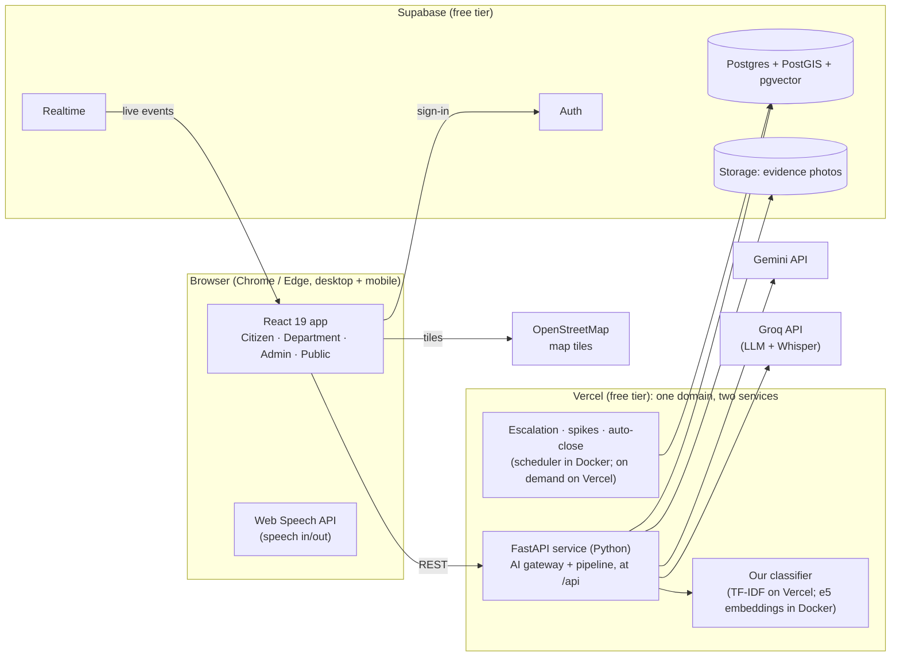

**Key decisions**

- **All AI/ML runs in Python** (FastAPI service): the trained classifier, embeddings, analysis pipeline, duplicate detection, priority scoring, resolution verification, spike detection and every LLM call. The React app only displays results. GitHub's language bar shows mostly TypeScript because the frontend is large; the AI/ML components are entirely Python.
- **One database for everything:** Supabase Postgres with PostGIS (wards, distances) and pgvector (semantic duplicates and search).
- **Realtime as a signal only:** the database publishes small "something changed" events; the app refetches through the API, so permissions are always enforced by the backend.
- **Graceful degradation:** every AI task has a fallback, answers are cached, and a demo mode replays cached AI responses so free-tier rate limits cannot break a demo. Where the embedding model can't be loaded (for example on a small free server), the classifier switches to its TF-IDF version and duplicates use lexical matching.

---

## 7. Tech stack

Everything below is free and open source, or used on a free tier.

| Layer | Technologies |
|---|---|
| **AI / ML (Python)** | Python 3.11, scikit-learn, sentence-transformers (PyTorch CPU), NumPy, pandas, SciPy, joblib, imagehash, Pillow |
| **LLM providers** | Google Gemini API (Flash, Flash-Lite) and Groq (GPT-OSS, Whisper), called over their REST APIs with httpx |
| **Backend** | FastAPI, Uvicorn, Pydantic v2, SQLAlchemy 2, psycopg 3, pgvector, APScheduler, slowapi, PyJWT, diskcache, shapely, exifread |
| **Database & platform** | Supabase (Postgres, PostGIS, pgvector, Auth, Storage, Realtime) |
| **Frontend** | React 19, Vite, TypeScript, Tailwind CSS v4, shadcn/ui (Radix), lucide-react |
| **Motion & 3D** | Motion for React, Three.js, React Three Fiber, drei, Lenis |
| **Data & state** | TanStack Query, TanStack Table, Zustand, i18next |
| **Maps** | Leaflet, react-leaflet, leaflet.heat, leaflet.markercluster, Turf.js, OpenStreetMap tiles (© OpenStreetMap contributors) |
| **Charts & export** | Recharts, SheetJS, jsPDF, html-to-image, qrcode |
| **Offline** | vite-plugin-pwa, IndexedDB (idb-keyval) |
| **Testing** | pytest, Playwright (Chromium, Microsoft Edge, mobile Chrome) |
| **Hosting** | Vercel (web app + FastAPI as two services on one domain), Supabase; the same API also runs as a Docker image (e.g. Render) |
| **Fonts** | Anek (Latin, Telugu, Devanagari), Noto Sans family, Noto Nastaliq Urdu, Noto Naskh Arabic, JetBrains Mono |

---

## 8. Screenshots

| | |
|---|---|
| 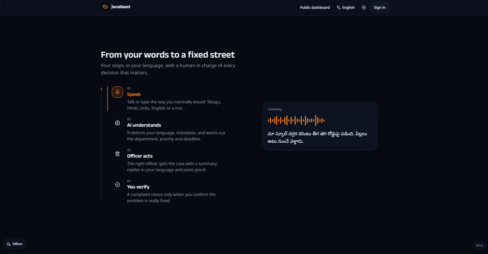 **From your words to a fixed street** | 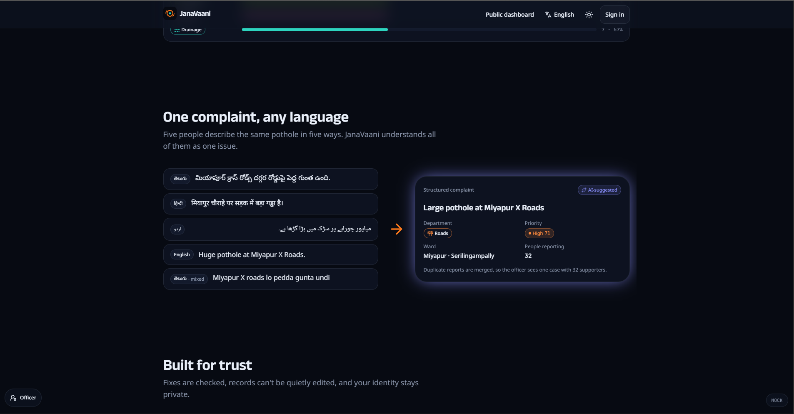 **Five languages, one case** |
| 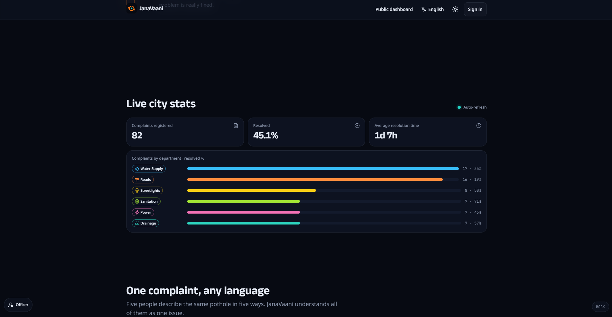 **Live city stats on the landing page** | 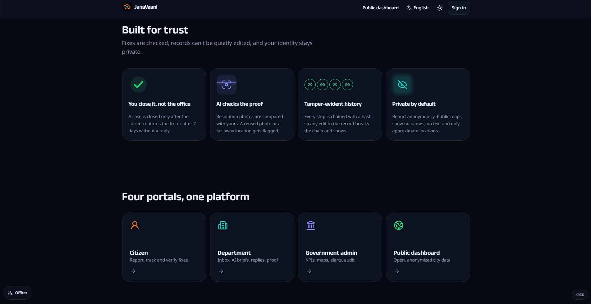 **Built for trust; four portals** |
| 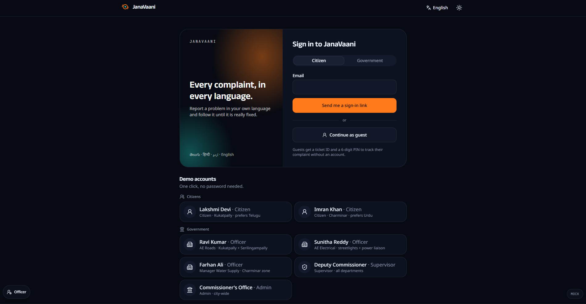 **Sign in, demo accounts, or continue as guest** | 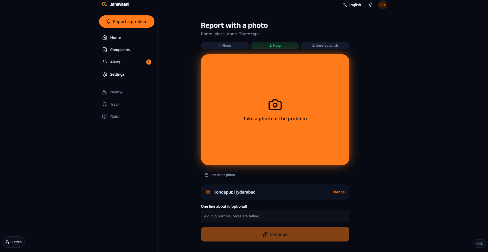 **Report with a photo in three taps** |
| 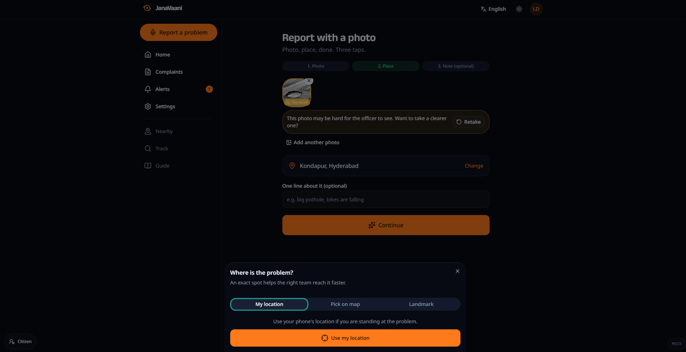 **Photo clarity check and location picker** | 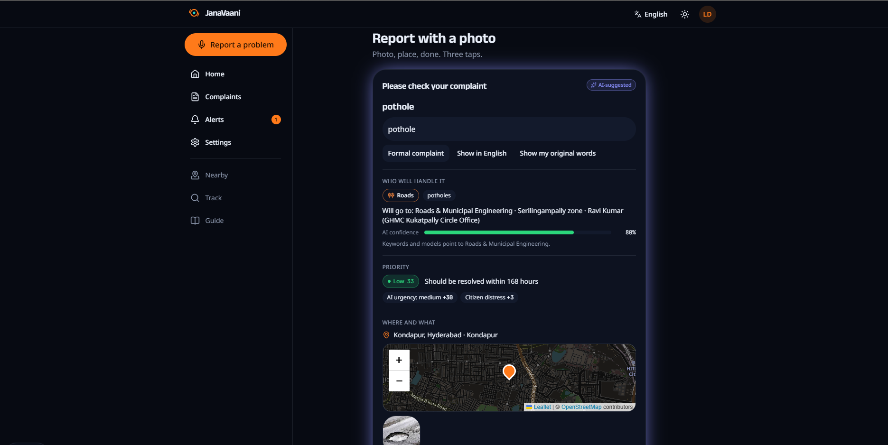 **AI-written complaint, routing, priority and map** |
| 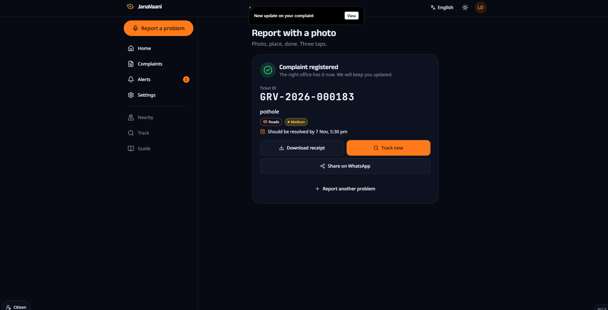 **Ticket ID, deadline, receipt and WhatsApp share** | 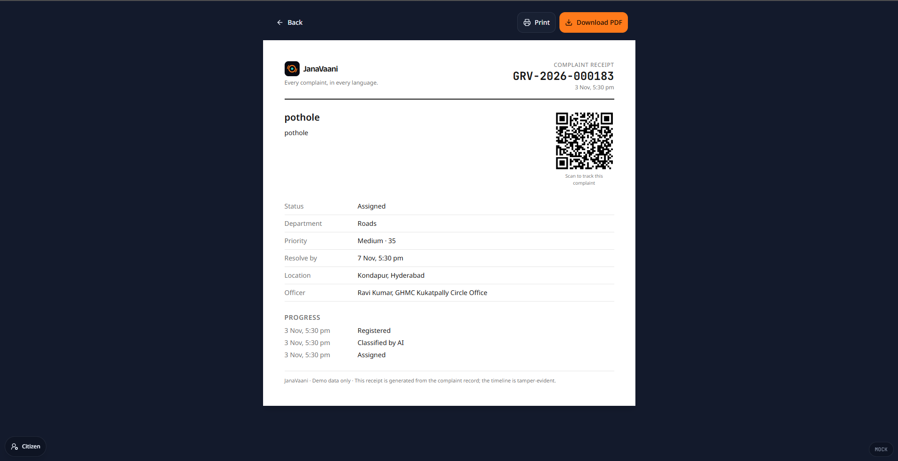 **Printable receipt with QR code** |
| 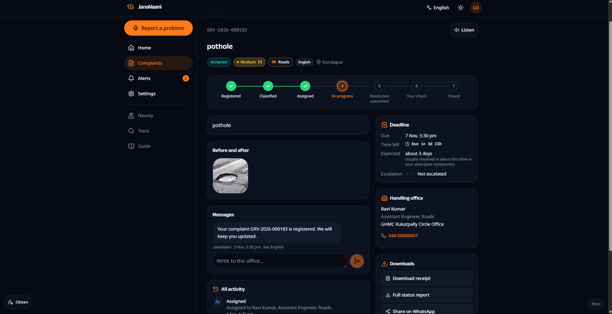 **7-step tracker, deadline, office and messages** | 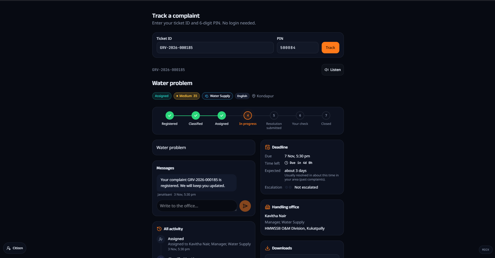 **Guest tracking with ticket ID + PIN** |
| 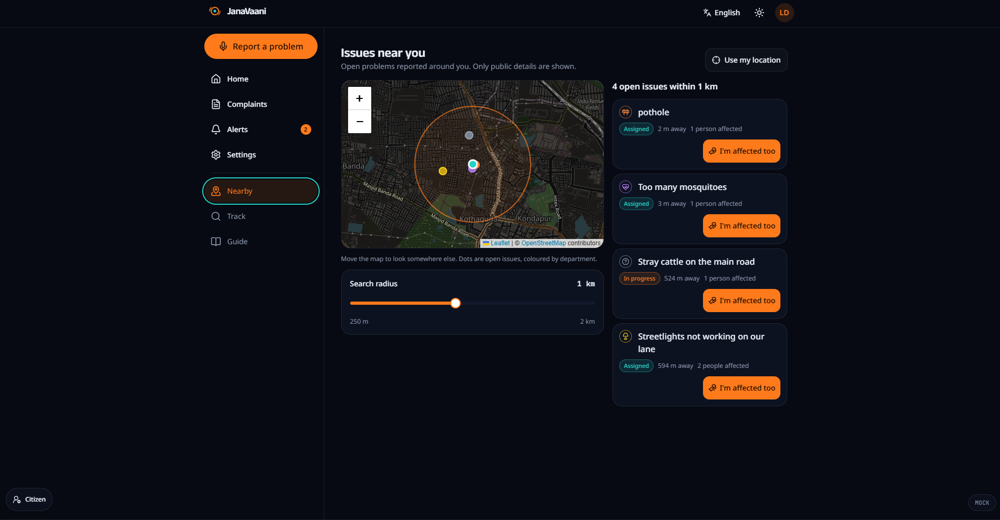 **Nearby issues with a search radius** | 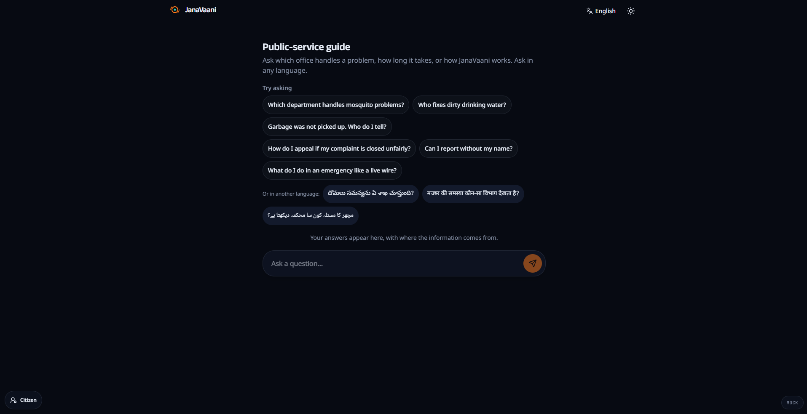 **Public-service guide, questions in any language** |
| 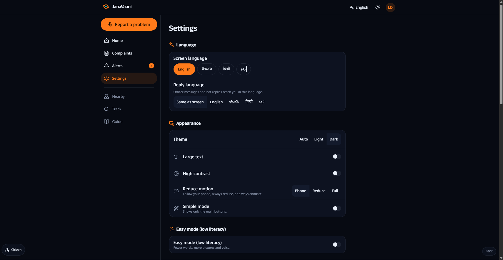 **Language, large text, high contrast, easy mode** | 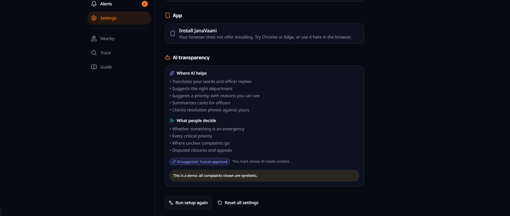 **AI transparency: what AI does, what people decide** |

---

## 9. Run it locally

> **Fastest way to look around:** the frontend runs with **no backend and no API keys** in mock mode (step 9.2, keep `VITE_API_MODE=mock`).

### 9.1 Prerequisites

- Node.js 20+ and npm
- Python 3.11+
- Free accounts: [Supabase](https://supabase.com), [Google AI Studio](https://aistudio.google.com) (Gemini key), [Groq](https://console.groq.com) (Groq key)
- Chrome or Edge (for voice features)

```bash
git clone https://github.com/Vidur-2007/JanaVaani.git
cd JanaVaani
```

### 9.2 Frontend

```bash
npm install
cp apps/web/.env.example apps/web/.env.local
npm run dev            # http://localhost:5173
```

`apps/web/.env.local`:

| Variable | Value |
|---|---|
| `VITE_API_MODE` | `mock` (no backend needed) · `hybrid` (live API, mock fallback) · `live` |
| `VITE_API_BASE_URL` | `http://localhost:8000/api/v1` or your deployed API |
| `VITE_SUPABASE_URL`, `VITE_SUPABASE_ANON_KEY` | From Supabase → Project Settings → API |
| `VITE_DEMO_MODE` | `true` shows one-click demo logins and demo controls |

### 9.3 Supabase

1. Create a project (region closest to India).
2. **Database → Extensions:** enable `postgis` and `vector`.
3. **Authentication → Providers:** enable **anonymous sign-ins** (used for guest reporting).
4. Copy the project URL, anon key, service role key, and the **Session pooler** connection string (Project Settings → Database).

> **No Supabase yet?** Leave `DATABASE_URL` and the Supabase values empty: the backend then runs in offline mode with a local SQLite database, and the AI falls back to rules and our model when no keys are set.

### 9.4 Backend and ML

```bash
cd services/api
python -m venv .venv
source .venv/bin/activate          # Windows: .venv\Scripts\activate
pip install torch --index-url https://download.pytorch.org/whl/cpu
pip install -r requirements.txt
cp .env.example .env               # fill in the keys below
cd ../..
```

> **Windows:** run `$env:PYTHONUTF8 = "1"` (PowerShell) before the Python commands below, so the Telugu, Hindi and Urdu data files are read as UTF-8.

`services/api/.env` (main values):

| Variable | Value |
|---|---|
| `SUPABASE_URL`, `SUPABASE_ANON_KEY`, `SUPABASE_SERVICE_ROLE_KEY` | From Supabase |
| `DATABASE_URL` | Supabase **Session pooler** URI (empty = local SQLite) |
| `GEMINI_API_KEY`, `GEMINI_MODEL_MAIN`, `GEMINI_MODEL_LITE` | From Google AI Studio |
| `GROQ_API_KEY`, `GROQ_MODEL_MAIN`, `GROQ_MODEL_SMALL`, `GROQ_WHISPER_MODEL` | From Groq console |
| `EMBEDDING_MODEL` | `intfloat/multilingual-e5-small` |
| `ALLOWED_ORIGINS` | `http://localhost:5173` |
| `APP_JWT_SECRET` | Any long random string (keeps sessions and guest PINs stable across restarts) |
| `DEMO_MODE` | `true` |

Set up the database, train the model and load demo data (run from the repo root, with the virtual environment active):

```bash
python ml/apply_migrations.py      # Supabase only: create tables, indexes, security policies
python ml/build_wards.py           # optional: rebuild the demo ward boundaries (already committed)
python ml/train_classifier.py      # train our department classifiers, e5 + TF-IDF (~seconds on CPU)
python ml/evaluate.py e5           # print accuracy tables, write ml/models/metrics.json
python ml/seed_db.py               # demo users, officers, wards, assets, ~600 complaints
```

> The synthetic dataset is already committed in `data/seed/complaints.jsonl`, and the trained models in `ml/models/`. To regenerate the dataset: `python ml/generate_dataset.py`.

Start the API:

```bash
cd services/api
uvicorn app.main:app --reload --port 8000
# Swagger docs: http://localhost:8000/docs   Health: http://localhost:8000/api/v1/health
```

Then set `VITE_API_MODE=hybrid` in the frontend and restart `npm run dev`.

### 9.5 Tests

```bash
cd services/api && pytest                 # backend: pipeline, safety rules, priority, routing, audit chain, fallbacks
cd ../.. && npx playwright install chromium msedge
npm run test:e2e                          # end-to-end on Chromium, Edge and mobile Chrome
npm run test:mocks && npm run test:voice && npm run test:i18n   # mock API, voice phrases, translation and RTL checks
```

### 9.6 Deploy (optional)

**Option A: frontend and backend together on Vercel (one domain).** `vercel.json` defines two [Vercel services](https://vercel.com/docs/services): `web` (the Vite app) and `api` (FastAPI, entry `vercel_api.py`). `/api/*` and `/docs` go to the API, and everything else to the app. Both services are rooted at the repo root, because the API reads `data/` and `ml/models/`. The API installs the slim root `requirements.txt`: no PyTorch, to stay under Vercel's 500 MB Python limit, so it uses the TF-IDF classifier.

1. Import the repo into Vercel with the **repo root** as the root directory.
2. Add the environment variables:
   - **App:** `VITE_API_MODE=live`, `VITE_API_BASE_URL=/api/v1`, `VITE_SUPABASE_URL`, `VITE_SUPABASE_ANON_KEY`, `VITE_DEMO_MODE=true`.
   - **API:** `DATABASE_URL`, `SUPABASE_URL`, `SUPABASE_ANON_KEY`, `SUPABASE_SERVICE_ROLE_KEY`, `GEMINI_API_KEY`, `GROQ_API_KEY`, `APP_JWT_SECRET`, `USE_EMBEDDINGS=false`, `ENABLE_SCHEDULER=false`, `AUTO_SEED=false`, `DEMO_MODE=true`, `UPLOAD_DIR=/tmp/uploads`, `AI_CACHE_DIR=/tmp/ai_cache`, `ALLOWED_ORIGINS=https://<project>.vercel.app`, `PUBLIC_API_URL=https://<project>.vercel.app`.
3. Deploy, then run `python ml/apply_migrations.py` and `python ml/seed_db.py` once against the production database (same `APP_JWT_SECRET`, `USE_EMBEDDINGS=false`).

Serverless functions don't keep a scheduler running, and Vercel's free plan runs cron jobs only once a day. So SLA escalations run when an admin advances the demo clock, not every 2 minutes. For the same reason, **Retrain** on the AI model page can't save a new model there (the bundle is read-only).

**Option B: frontend on Vercel, backend on Render (Docker).**

- **Frontend (Vercel):** the same import, with `VITE_API_BASE_URL=<your API>/api/v1`. Values are baked in at build time, so redeploy after changing them. The `api` service still deploys on Vercel, but the app doesn't use it.
- **Backend (Render):** create a Docker web service from this repo using `services/api/Dockerfile` (build context: repo root). Add the backend variables in **Environment**, and include your Vercel address in `ALLOWED_ORIGINS`. The scheduler runs normally here. Then run `python ml/apply_migrations.py` and `python ml/seed_db.py` once against the production database.

---

## 10. Demo accounts and walkthrough

With `VITE_DEMO_MODE=true` the login page shows one-click buttons for every account. All use password `Demo@2026`. The `.test` domain is reserved, so no real email is ever sent.

| Role | Email | Persona |
|---|---|---|
| Citizen | `lakshmi@janavaani.test` | Lakshmi Devi, Kukatpally, prefers Telugu |
| Citizen | `imran@janavaani.test` | Imran Khan, Charminar, prefers Urdu |
| Officer | `ravi.roads@janavaani.test` | Ravi Kumar, Assistant Engineer, Roads |
| Officer | `sunitha.electrical@janavaani.test` | Sunitha Reddy, Assistant Engineer, Electrical |
| Officer | `farhan.water@janavaani.test` | Farhan Ali, Manager, Water Supply |
| Supervisor | `supervisor@janavaani.test` | Deputy Commissioner |
| Admin | `admin@janavaani.test` | Commissioner's Office |

Or click **Continue as guest** to report without an account.

### Try these (5 minutes)

1. **Voice, in Telugu:** log in as Lakshmi → *Report by voice* → say *"మా స్కూల్ దగ్గర కరెంటు తీగ తెగి రోడ్డు మీద పడింది"* ("A live wire has snapped and fallen on the road near our school"). Watch the emergency screen, then the formal complaint, routing to Power, priority score and SLA.
2. **Tenglish + photo:** *Report with photo* → any pothole photo → type *"Miyapur X roads lo pedda gunta undi"*. The app finds the existing cluster of reports and offers to add your support.
3. **Officer:** log in as Ravi → open the top case → see the original Telugu next to the English translation and the AI brief → *Draft with AI* → send (the citizen receives it in Telugu, with audio).
4. **Fake fix caught:** open the Ameerpet streetlight case → the AI verification says **suspicious** (the "proof" photo is the citizen's own photo).
5. **Admin:** log in as admin → see the contaminated-water **spike alert** in Charminar → *Demo controls → +48h* and watch SLA escalations fire → *AI Model* page → retrain from corrections.

All demo data is **synthetic** and was generated for this hackathon.

---

## 11. Privacy, safety and responsible AI

- **Personal data masking:** Aadhaar, phone numbers, emails and PAN numbers are masked before any text is sent to an AI provider, and on officer screens.
- **Original words are never lost:** AI cleaning and formal rewriting are shown for approval; the citizen's original text is always stored and viewable.
- **Humans make the high-stakes calls:** emergency confirmation, critical priority, low-confidence routing, disputed closures and appeals.
- **Safety rules beat AI:** emergency keyword rules set a minimum priority that the AI cannot lower, and emergency numbers appear before any AI call completes.
- **Anonymous and private modes;** anonymous complaints hide the citizen's identity from officers.
- **Public data is anonymized:** aggregates only, map points blurred by ~75 m, no text, no identities, private complaints excluded.
- **Tamper-evident audit:** every action is a SHA-256 hash-chained event; any edit breaks the chain and is detected.
- **Uploads are sanitized:** images only, size-limited, re-encoded, location metadata read for verification and then stripped.
- **AI transparency notices** and a privacy notice in Telugu, Hindi, Urdu and English; AI-generated content is visibly marked.
- **Synthetic data only:** free AI tiers may use inputs to improve their models, so no real citizen data was ever used. A real deployment would use paid or self-hosted models with data-processing agreements, and follow India's Digital Personal Data Protection framework.

---

## 12. AI tools used

As required by the rules, here is every AI tool we used.

**To build the project**

| Tool | How we used it |
|---|---|
| **Claude** (Anthropic): Claude Code with 3 Claude Pro accounts, and the Claude app for planning | Our only AI development tool. We used Claude to choose the problem statement, plan the features, tech stack and AI workflow, and write a shared specification and API contract. Then each team member used Claude Code on their own branch to implement their part (citizen portal, AI engine, government portals). Our planning specs and phase-by-phase prompts are in [`docs/specs`](docs/specs) and [`docs/prompts`](docs/prompts). |

No other AI coding assistants (ChatGPT, Copilot, Cursor, etc.) were used.

**Inside the product (runtime)**

| Tool | How the product uses it |
|---|---|
| **Google Gemini API** (Flash, Flash-Lite) | Conversation, complaint analysis, translation, citizen replies, photo understanding, resolution verification |
| **Groq** (open LLMs + Whisper) | Routing second opinion, officer briefs and reply drafts, trend summaries, speech-to-text fallback, and fallback for every Gemini task |
| **Sentence-transformers** (open multilingual embedding model) | Embeddings for our classifier, duplicate detection and cross-language search |
| **Our own classifier** (scikit-learn) | Department routing, trained by us |

All AI-generated code was reviewed, run and tested by the team.

---

## 13. Limitations and future work

**Honest limitations**

- **Synthetic data.** The training data and demo complaints are template-generated, and the hand-written test set is small (48 complaints). Real accuracy must be measured on real, consented complaints.
- **Approximate boundaries.** The 30 demo wards are generated from locality centres, not official GHMC boundaries, and are labelled as such in the app.
- **Illustrative departments.** Department and officer mappings are examples; a real deployment must follow the city's official jurisdiction mapping.
- **Free-tier limits.** Gemini and Groq free tiers are rate-limited, and Gemini's main Flash model is sometimes overloaded, so the live demo relies on caching and the Groq fallback. After a quiet period, the first API request takes several seconds while the serverless function starts.
- **Serverless trade-offs on Vercel.** The live demo uses the TF-IDF version of our classifier (the e5 model is too large for a serverless bundle). SLA escalations run when an admin advances the demo clock, not on a timer. Retraining can't save a new model there. The Docker deployment has none of these limits.
- **Four full languages.** Six more Indian languages are understood, but the app's screens, voice phrases and safety keywords are only in Telugu, Hindi, Urdu and English.
- **Browser voices.** Text-to-speech depends on the voices installed on the device; Telugu and Urdu voices may be missing on some Windows machines.

**Next steps**

- Integrate with existing systems (CPGRAMS, state grievance portals) and official GIS ward data.
- Self-hosted Indian-language models (e.g. IndicTrans2, Indic speech models, Bhashini) for data sovereignty.
- Full app support for more languages (Tamil, Kannada, Marathi and others), with native-speaker review of the safety keywords.
- WhatsApp and IVR channels through approved government providers.
- Fine-tuned classifier on real labelled complaints; image-similarity duplicates; predictive maintenance.

---

## 14. Repository structure

```
JanaVaani/
├─ apps/web/                 React app (all portals)
│  └─ src/
│     ├─ app/                router, providers, app shell
│     ├─ design/             design tokens, shared components, motion, 3D
│     ├─ lib/                API client, auth, i18n, realtime, speech
│     ├─ i18n/locales/       en, te, hi, ur
│     └─ portals/            landing, citizen, officer, admin, public, gov-shared
├─ packages/contracts/       shared API types + mock data
├─ services/api/             FastAPI backend (Python): AI gateway, pipeline, routers, tests
├─ ml/                       training, evaluation, seeding scripts, model files, notebook
├─ data/                     departments, wards, keywords, knowledge base, seed + eval data
├─ supabase/migrations/      database schema
├─ scripts/                  demo recording, latency, production smoke test, tamper demo
├─ e2e/                      Playwright tests
└─ docs/                     specs, prompts, architecture, runbook, screenshots
```

---

<div align="center">

Built in 48 hours for **Neural Storm 2026** by **Team Maximus Decimus Meridius**: Vidur Bandaru, Murari Guddam and Anugnya.S.

*"What we do in life echoes in eternity."*

</div>
