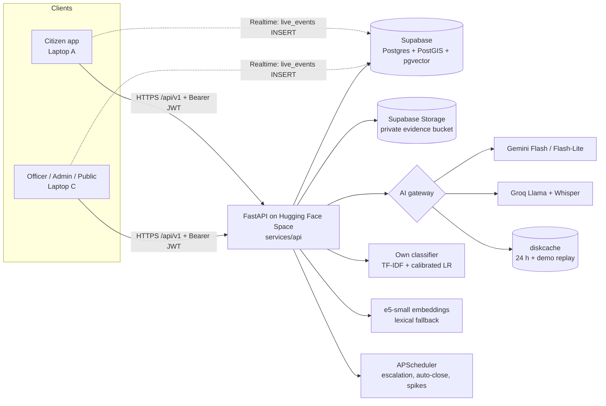
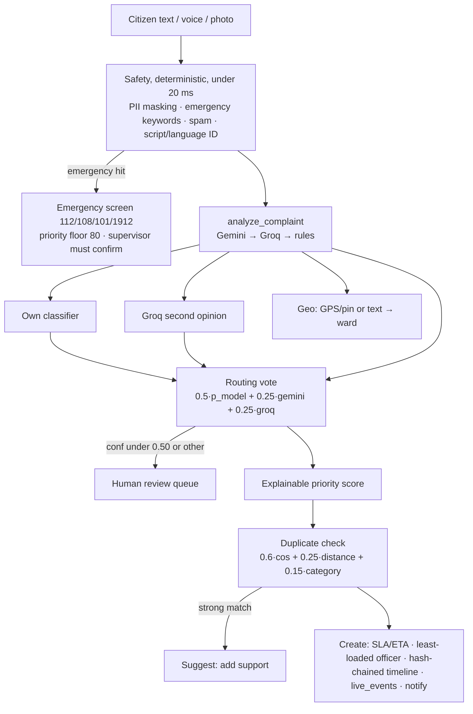

# JanaVaani — Backend & AI architecture (Laptop B)

## System

## Per-complaint AI pipeline

## Gateway fallback table

| Task | Primary | Fallback | If both fail |
|---|---|---|---|
| analyze_complaint | Gemini MAIN (multimodal) | Groq MAIN (text) | rules + classifier; English text = original |
| route_second_opinion | Groq MAIN | Gemini LITE | classifier-only vote (confidence = p) |
| translate | Gemini MAIN | Groq MAIN | 503 `translation_unavailable` (never faked) |
| localize_reply | Gemini MAIN | Groq MAIN | built-in te/hi/ur phrasebook, else English labelled `lang: en` |
| officer_brief | Groq MAIN | Gemini LITE | deterministic brief, `generated_by: fallback` |
| draft_reply | Groq MAIN | Gemini LITE | intent templates |
| verify_resolution | Gemini MAIN (vision) | — | `unclear` / `needs_human_review` (rules still flag same photo or >500 m) |
| insights_summary | Groq MAIN | Gemini LITE | template sentences (numbers guard) |
| guide_answer | Gemini LITE | Groq MAIN | keyword retrieval over service_guide.md with citations |
| spam_check | Gemini LITE | Groq SMALL | heuristic score |
| transcribe | Groq Whisper turbo | whisper-large-v3 | 501 → browser speech |

Timeouts 12 s (vision 20 s), one jittered retry on 429/5xx/timeout, Pydantic validation + one repair call. Every call is logged to `ai_calls`; `FORCE_FAIL_GEMINI` / `FORCE_FAIL_GROQ` simulate outages.

## Free tiers used
Supabase (DB, auth, storage, realtime) · Hugging Face Spaces (Docker CPU) · Gemini API free tier · Groq free tier · Nominatim/OSM (not yet wired) · CARTO basemaps (frontend).

## Privacy measures
- PII (Aadhaar, phone, email, PAN) masked before any AI call; only `description_masked` reaches providers; officers see masked text, admins only see the original.
- Anonymous mode hides citizen identity from officers; private mode excludes a grievance from every public endpoint.
- Public map jittered ≈75 m, no ids or text; recent fixes show proof photos only, never citizen photos.
- Uploads: EXIF GPS read then all EXIF stripped, re-encoded to WebP.
- Hash-chained, append-only timeline (DB trigger on Postgres) with `/admin/audit/verify`.
- Synthetic data only.

## Offline mode
Without `DATABASE_URL` and AI keys the API runs on a local SQLite file with deterministic fallbacks: every endpoint works, which is how the test suite runs. Fill `services/api/.env` to switch to Supabase + Gemini/Groq; nothing else changes.
